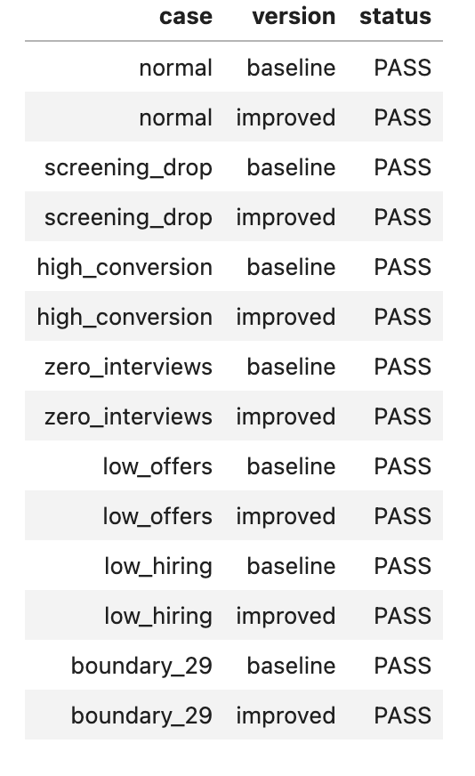
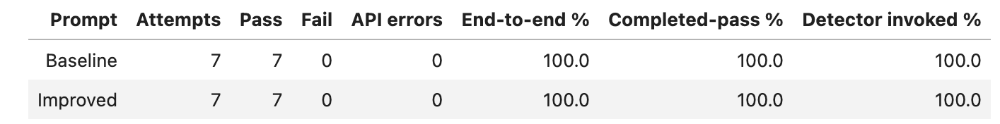
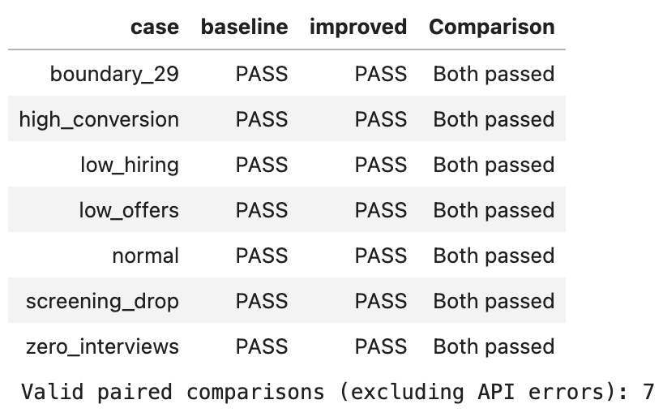
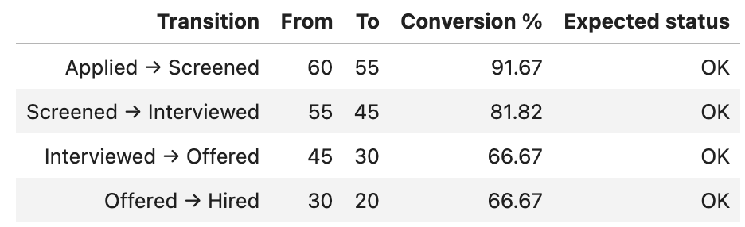

# Recruitment Data Detective

**AI-powered recruitment analytics and investigation.**

Recruitment Data Detective *helps hiring teams turn recruitment data into actionable insights*. Upload a CSV, explore hiring funnel metrics, and use Gemini AI to investigate potential bottlenecks.

## Features

- **CSV Analysis** — Upload and explore recruitment datasets.
- **Hiring Funnel** — Visualize applications, interviews, offers, and hires.
- **AI Investigation** — Generate evidence-based insights and recommendations.
- **Interactive Dashboard** — Explore recruitment metrics in Streamlit.

## Live Demo

[Try Recruitment Data Detective](https://zeilhackathon-xeplyzqyyufyg2cncwebfp.streamlit.app/)

## Evaluation and Validation

We evaluated the recruitment investigation workflow against **seven synthetic scenarios** using both a **baseline** and an **improved** prompt configuration. Each scenario was run once per configuration, for **14 total evaluation attempts**. The scenarios cover healthy conversion, screening drop-off, high conversion, no interviews, low offer rates, low hiring rates, and a 29% conversion boundary case.

### Test cases

All 14 recorded attempts passed their configured checks.



### Evaluation summary

| Metric | Baseline | Improved |
| --- | ---: | ---: |
| Attempts | 7 | 7 |
| Pass | 7 | 7 |
| Fail | 0 | 0 |
| API errors | 0 | 0 |
| End-to-end pass rate | 100% | 100% |
| Completed-run pass rate | 100% | 100% |
| Detector invoked | 100% | 100% |



### Paired comparison

All **seven valid paired comparisons** had the same outcome: both configurations passed. This confirms that both prompt configurations satisfied the tested checks on these cases; **it does not demonstrate an improvement in pass rate**, since the baseline already scored 100%.



### Example: normal hiring funnel

The `normal` synthetic scenario serves as a negative-control example: all four stage-to-stage transitions are expected to be marked `OK`.

| Transition | From | To | Conversion | Expected status |
| --- | ---: | ---: | ---: | --- |
| Applied → Screened | 60 | 55 | 91.67% | OK |
| Screened → Interviewed | 55 | 45 | 81.82% | OK |
| Interviewed → Offered | 45 | 30 | 66.67% | OK |
| Offered → Hired | 30 | 20 | 66.67% | OK |



**Evaluation scope:** These results describe the seven scenarios and 14 runs shown above. They are not a benchmark of performance on real-world recruitment datasets, nor do they establish that the improved prompt outperforms the baseline.

## Tech Stack

Python · Streamlit · Pandas · Google Gemini API

## Quick Start

```bash
git clone https://github.com/vicmon810/ZEIL_HACKATHON.git
cd ZEIL_HACKATHON

pip install -r requirements.txt
```

Create a `.env` file:

```env
GEMINI_API_KEY=your_api_key
```

Run the application:

```bash
streamlit run app.py
python gemini_live_bridge.py # for gemini voice control
```

## Roadmap

- [ ] AI-driven anomaly detection
- [ ] Gemini function calling
- [ ] Structured investigation reports
- [ ] Public deployment

## About

Built for **ZEIL Hackathon 2026**.<br>
**Using ChatGPT for coding assistants.**
